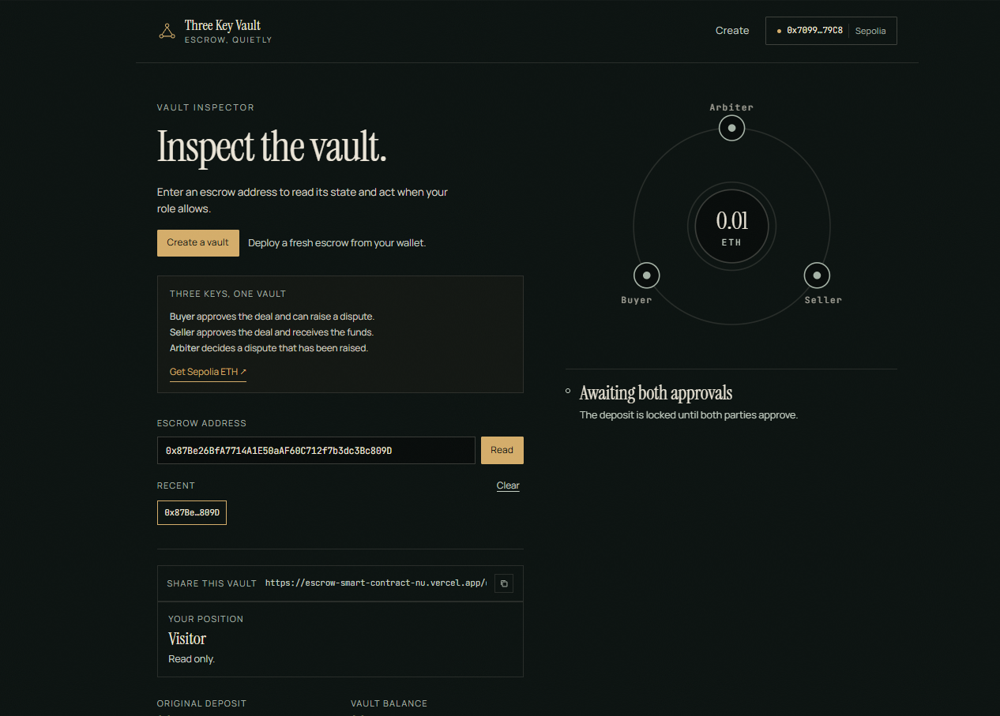
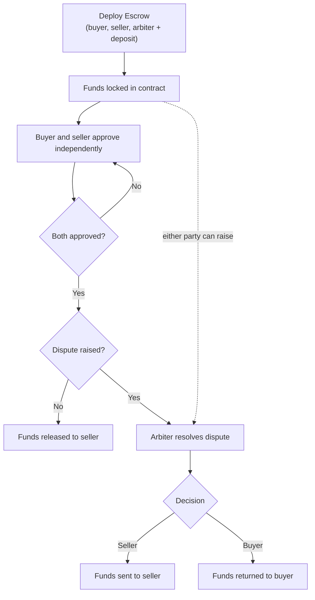
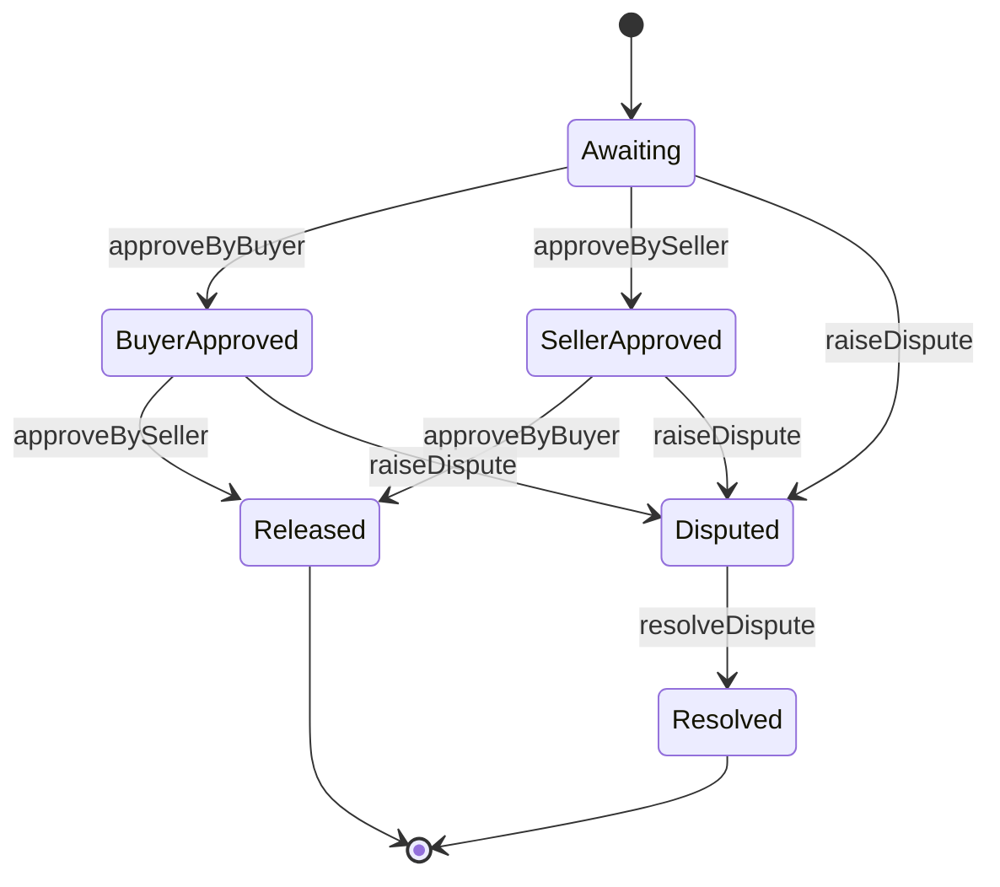

<div align="center">

# Three Key Vault

**A three-party Ethereum escrow: a Solidity contract built and tested with Foundry, and a web interface to use it.**

[](https://escrow-smart-contract-nu.vercel.app/)
[](https://sepolia.etherscan.io/address/0x87Be26BfA7714A1E50aAF60C712f7b3dc3Bc809D)


[Live App](https://escrow-smart-contract-nu.vercel.app/) ·
[Etherscan](https://sepolia.etherscan.io/address/0x87Be26BfA7714A1E50aAF60C712f7b3dc3Bc809D) ·
[Sourcify](https://repo.sourcify.dev/contracts/full_match/11155111/0x87Be26BfA7714A1E50aAF60C712f7b3dc3Bc809D/) ·
[Blockscout](https://eth-sepolia.blockscout.com/address/0x87Be26BfA7714A1E50aAF60C712f7b3dc3Bc809D)

</div>

<!--
Screenshots: add images to docs/images/ and uncomment.

<p align="center">
  
  
</p>
-->

## Overview

An escrow holds funds until agreed conditions are met. Instead of paying the seller directly, the depositor locks Ether in a smart contract. The money is released to the seller only when **both** parties approve. If they disagree, either one can raise a dispute and an independent **arbiter** decides who receives the funds.

This repository contains the whole stack:

| Layer | What it is | Where |
|---|---|---|
| Smart contract | Solidity escrow with role-based access, custom errors and dispute resolution | [`src/Escrow.sol`](src/Escrow.sol) |
| Test suite | 18 Foundry tests, 100% line, statement, branch and function coverage | [`test/Escrow.t.sol`](test/Escrow.t.sol) |
| Deployment | Live on Ethereum Sepolia, source verified on three explorers | [Live deployment](#live-deployment) |
| Web interface | Read vault state, act by role, deploy new escrows from the browser | [`frontend/`](frontend) |

## Highlights

- **Contract and tests written by hand.** Every function, access rule and failure path in the contract has a dedicated test, including recipients that refuse Ether.
- **Verified on three independent explorers.** Etherscan, Sourcify and Blockscout all show the exact source that is deployed.
- **Custom errors instead of revert strings.** Six typed errors, each covered by a negative test.
- **A UI that respects the contract's limits.** The contract emits no events and keeps no "released" flag, so the interface derives the vault status from on-chain state and balance instead of guessing.
- **Safe by construction on the client.** Every write is simulated first, actions that cannot succeed are disabled with the reason, and every custom error is translated into a plain sentence.
- **Deploy your own escrow from the browser**, with address validation, a review step, and read-back verification of the deployed contract.

## Live Deployment

| | |
|---|---|
| Network | Ethereum Sepolia (chain ID `11155111`) |
| Contract | [`0x87Be26BfA7714A1E50aAF60C712f7b3dc3Bc809D`](https://sepolia.etherscan.io/address/0x87Be26BfA7714A1E50aAF60C712f7b3dc3Bc809D) |
| Initial deposit | 0.01 ETH |
| Compiler | Solidity 0.8.37 |
| Web app | [escrow-smart-contract-nu.vercel.app](https://escrow-smart-contract-nu.vercel.app/) |

This is a testnet deployment that uses test Ether. The reference instance has fixed participants, so it is meant for reading. To try the full flow with your own wallets, open the app and use **Create** to deploy a fresh escrow.

## How It Works



### Participants

| Role | Can do |
|---|---|
| **Buyer** | Approve the deal, raise a dispute |
| **Seller** | Approve the deal, raise a dispute, receives the funds on release |
| **Arbiter** | Resolve a raised dispute in favour of the seller or the buyer |

The deposit is paid by whoever deploys the contract. The buyer, seller and arbiter are stored addresses, so the deployer does not have to be the buyer.

## Smart Contract

The contract lives in a single file, [`src/Escrow.sol`](src/Escrow.sol), and is initialised through a payable constructor.

```solidity
constructor(address _buyer, address _seller, address _arbiter) payable {
    buyer = _buyer;
    seller = _seller;
    arbiter = _arbiter;
    amount = msg.value;
}
```

One contract instance represents one deal.

### State

| Variable | Type | Purpose |
|---|---|---|
| `buyer` | `address` | Buyer of the deal |
| `seller` | `address` | Receives the funds on release |
| `arbiter` | `address` | Resolves disputes |
| `amount` | `uint256` | Deposit recorded at deployment (`msg.value`) |
| `buyerApproved` | `bool` | Buyer approval flag |
| `sellerApproved` | `bool` | Seller approval flag |
| `isDisputeRaised` | `bool` | Blocks automatic release when `true` |

### Functions

| Function | Caller | Behaviour |
|---|---|---|
| `approveByBuyer()` | buyer | Records approval, then attempts release |
| `approveBySeller()` | seller | Records approval, then attempts release |
| `raiseDispute()` | buyer or seller | Sets the dispute flag, which blocks automatic release |
| `resolveDispute(bool _approveForSeller)` | arbiter | Requires a raised dispute; pays the seller (`true`) or refunds the buyer (`false`) |
| `releaseIfAgreed()` | internal | Pays the seller when both approved and no dispute is raised |

Approvals can arrive in either order. Release happens inside the second approval transaction.

### Custom Errors

```solidity
error Escrow_onlyBuyer();
error Escrow_onlySeller();
error Escrow_onlyBuyerOrSeller();
error Escrow_onlyArbiter();
error Escrow_NoDisputeRaised();
error Escrow_TransferFailed();
```

Custom errors return a compact selector instead of an encoded string, which keeps reverts cheaper and makes failures easy to assert in tests and to decode off-chain.

### Ether Transfers

Payouts use a low-level `call` and check its result:

```solidity
(bool success, ) = seller.call{value: amount}("");
if (!success) revert Escrow_TransferFailed();
```

If a recipient cannot receive Ether, the whole transaction reverts instead of silently losing funds. The test suite includes a `RejectEther` contract to exercise exactly this path for both the seller and the buyer.

## Testing

```bash
forge test            # run the suite
forge test -vvvv      # with execution traces
forge coverage        # coverage report
```

**18 tests, 0 failures, 100% coverage** (lines, statements, branches, functions).

| Area | Tests |
|---|---|
| Initialisation | `test_Constructor` checks addresses, amount, balance and initial flags |
| Access control | `test_approveByBuyer_RevertIfNotBuyer`, `test_approveBySeller_RevertIfNotSeller`, `test_raiseDispute_RevertsIfNotBuyerOrSeller`, `test_ResolveDispute_RevertsIfNotArbiter` |
| Approvals without release | `test_approveByBuyer_NoReleaseWhenSellerHasNotApproved`, `test_approveBySeller_NoReleaseWhenBuyerHasNotApproved` |
| Release in both orders | `test_releaseWhenBuyerThenSellerApprove_transferFundsToSeller`, `test_releaseWhenSellerThenBuyerApprove_transferFundsToSeller` |
| Dispute blocks release | `test_Release_DoseNotHappen_WhenDisputeRaised` |
| Raising disputes | `test_raiseDispute_ByBuyer`, `test_raiseDispute_BySeller` |
| Resolving disputes | `test_ResolveDispute_ApproveForSeller`, `test_ResolveDispute_ApproveForBuyer`, `test_ResolveDispute_RevertsIfNoDisputeRaised` |
| Failed transfers | `test_Release_RevertsOnTransferFailure_WhenSellerCannotReceiveEther`, `test_ResolveDispute_RevertsOnTransferFailure_ToSeller`, `test_ResolveDispute_RevertsOnTransferFailure_ToBuyer` |

Coverage shows which code was executed by tests. It is not a security audit.

## Deployment and Verification

The contract was deployed to Sepolia with Foundry (`forge create`) using a keystore account, so no raw private key appears in any command or file. Deployment and verification are wrapped in the [`Makefile`](Makefile):

```bash
make deploy    # deploys with BUYER, SELLER, ARBITER from .env and a 0.01 ETH deposit
make verify    # submits the source for verification on Etherscan
```

### Verified on three explorers

| Explorer | Link |
|---|---|
| Etherscan | [View source](https://sepolia.etherscan.io/address/0x87Be26BfA7714A1E50aAF60C712f7b3dc3Bc809D#code) |
| Sourcify (full match) | [View source](https://repo.sourcify.dev/contracts/full_match/11155111/0x87Be26BfA7714A1E50aAF60C712f7b3dc3Bc809D/) |
| Blockscout | [View contract](https://eth-sepolia.blockscout.com/address/0x87Be26BfA7714A1E50aAF60C712f7b3dc3Bc809D) |

**Check it yourself:**

1. Open the Etherscan link and the **Contract** tab. The source of `Escrow` is shown with a verified checkmark.
2. Compare it with [`src/Escrow.sol`](src/Escrow.sol) in this repository.
3. On Sourcify, a `full_match` means the compiled bytecode and metadata match the deployed contract exactly.
4. Use **Read Contract** on any explorer to query `buyer`, `seller`, `arbiter`, `amount` and the flags directly from the chain.

Verification makes the source publicly inspectable. It does not make the contract safe for production use.

## Web Interface

The interface is a single-page app in [`frontend/`](frontend), deployed on Vercel: **[escrow-smart-contract-nu.vercel.app](https://escrow-smart-contract-nu.vercel.app/)**

### Features

- **Inspect any escrow** by address, with a recent list stored locally and shareable deep links (`/escrow/:address`).
- **Role detection.** The connected wallet is recognised as buyer, seller, arbiter or visitor (including one address holding several roles) and sees only the actions its role allows, with the reason shown for everything disabled.
- **Act on a vault:** approve, raise a dispute, and resolve with two explicit choices (pay seller or refund buyer) behind a confirmation step.
- **Transaction lifecycle:** waiting for wallet, pending, confirmed or failed, with an explorer link on Sepolia.
- **Create an escrow** from the browser with field validation, a review screen, and read-back verification of the deployed contract.
- **Wallet connection** through EIP-6963 discovery (MetaMask, Rabby, Coinbase Wallet and others) with a wrong-network guard and one-click switch.

### Status Derived From Chain State

The contract emits no events and has no "released" flag, so the app derives meaning from what can be read:

| Condition | Shown as |
|---|---|
| No approvals, no dispute, funds locked | Awaiting both approvals |
| Only buyer approved | Buyer approved |
| Only seller approved | Seller approved |
| Dispute raised, funds still locked | Disputed, awaiting the arbiter |
| Funds gone, not both approved | Resolved by the arbiter |
| Funds gone, both approved, no dispute | Released to the seller |
| Funds gone, both approved, dispute flag set | Settled (route cannot be read from state, link to internal transactions) |

"Funds gone" means `amount > 0` and the contract balance is `0`. When the payout recipient cannot be proven from state, the interface says so and links to the internal transactions instead of guessing.



### Client-Side Safety

- Every write goes through `simulateContract` before the wallet is asked to sign.
- Actions that cannot succeed are disabled with a plain explanation, for example approving after a dispute or acting on a settled vault.
- All six custom errors, wallet rejection, insufficient funds, wrong network and RPC failure are translated into human sentences.
- The create form requires valid checksummed addresses, rejects zero addresses and zero amounts, and warns when two roles share an address or when a role equals the deployer.
- After deployment, the app reads buyer, seller, arbiter and amount back from the chain and checks them against what was submitted.

### Tech Stack

| Area | Choice |
|---|---|
| Framework | React 19, Vite, TypeScript (strict) |
| Web3 | wagmi v2, viem, EIP-6963 wallet discovery |
| Data | TanStack Query with block-based refetching |
| Motion | Framer Motion, reduced-motion respected |
| Routing | react-router-dom |
| Styling | Plain CSS with design tokens, self-hosted fonts (Instrument Serif, Geist, Geist Mono) |
| Hosting | Vercel (static build, SPA fallback) |

### Design

A dark, quiet interface built around one idea: three keys, one vault. The buyer, seller and arbiter are three nodes on a ring around the locked amount. Each approval draws its arc, a completed ring opens toward the seller, a dispute turns the ring terracotta and makes the arbiter node breathe, and a settled vault goes still.

### Run the Interface Locally

```bash
cd frontend
npm install
npm run dev
```

Open `http://localhost:5173`. By default it reads the Sepolia reference deployment using public RPC endpoints.

#### Test against a local Anvil node

```bash
# terminal 1
anvil
```

```bash
# terminal 2, from the repository root
forge create src/Escrow.sol:Escrow \
  --rpc-url http://127.0.0.1:8545 \
  --unlocked --from 0xf39Fd6e51aad88F6F4ce6aB8827279cffFb92266 \
  --broadcast --value 0.01ether \
  --constructor-args <BUYER> <SELLER> <ARBITER>
```

Create `frontend/.env.local` with the deployed address:

```env
VITE_ENABLE_LOCAL=true
VITE_ESCROW_ADDRESS=<deployed address>
```

Add Anvil (`http://127.0.0.1:8545`, chain ID `31337`) to your wallet and import the buyer, seller and arbiter accounts that Anvil prints. Those keys are public development keys and must never be used on a real network.

#### Environment variables

| Variable | Purpose | Default |
|---|---|---|
| `VITE_ESCROW_ADDRESS` | Escrow shown on the home page | Sepolia reference deployment |
| `VITE_SEPOLIA_RPC_URL` | Custom Sepolia RPC | Public fallback endpoints |
| `VITE_WALLETCONNECT_ID` | Enables the WalletConnect connector | Off |
| `VITE_ENABLE_LOCAL` | Adds the Anvil chain (development only) | `false` |
| `VITE_ENABLE_LAB` | Design preview route (development only) | `false` |

`VITE_*` values are embedded in the public bundle. Never put secrets in them. Production builds run on Sepolia only.

### Deploy to Vercel

| Setting | Value |
|---|---|
| Root Directory | `frontend` |
| Framework Preset | Vite |
| Build Command | `npm run build` |
| Output Directory | `dist` |

`vercel.json` rewrites deep links to `index.html`, and `public/_redirects` provides the same fallback for Netlify.

## Repository Structure

```text
escrow-smart-contract/
├── src/
│   └── Escrow.sol              # the contract
├── test/
│   └── Escrow.t.sol            # 18 Foundry tests
├── frontend/
│   ├── src/
│   │   ├── components/         # vault glyph, wallet modal, action panel, tx status
│   │   ├── config/             # env and wagmi setup
│   │   ├── contracts/          # typed ABI and creation bytecode
│   │   ├── hooks/              # useEscrow, useRole, useEscrowWrite, useDeployEscrow
│   │   ├── lib/                # status derivation, error decoding, validation
│   │   ├── pages/              # home, create
│   │   └── styles/             # tokens and base styles
│   ├── public/
│   └── vercel.json
├── days/                       # development journal (day 01, day 02)
├── lib/forge-std/
├── Makefile                    # deploy and verify commands
├── foundry.toml
└── README.md
```

## Getting Started (Contract)

Requirements: Git and [Foundry](https://book.getfoundry.sh/getting-started/installation).

```bash
git clone https://github.com/Hassan5737/escrow-smart-contract.git
cd escrow-smart-contract
forge install
forge build
forge test
```

To deploy your own instance, create a local `.env` (never commit it):

```env
RPC_URL=YOUR_SEPOLIA_RPC_URL
BUYER=YOUR_BUYER_ADDRESS
SELLER=YOUR_SELLER_ADDRESS
ARBITER=YOUR_ARBITER_ADDRESS
ETHERSCAN_API_KEY=YOUR_ETHERSCAN_API_KEY
```

Then run `make deploy` and `make verify` (update the address in the `verify` target to your deployment).

## Security Notes and Known Limitations

This is an educational implementation. It is **not audited** and must not hold real funds.

Known limitations, documented on purpose:

- No explicit "released" or finalized state after a payout.
- `resolveDispute` can be called again after a payout and reverts only because the balance is zero.
- `raiseDispute` has no settlement guard.
- No reentrancy guard and no checks-effects-interactions state transition.
- The constructor does not reject zero addresses or a zero deposit.
- No events for approvals, disputes or transfers.

The web interface compensates for these where it can (balance-based status, disabled actions, input validation on creation), but only the contract itself can fix them.

## Roadmap

A second contract version is planned to address the points above:

- Explicit lifecycle states (funded, disputed, released, refunded) with guarded transitions.
- Checks-effects-interactions ordering and a reentrancy guard.
- Constructor validation for addresses and deposit.
- Events for every state change, so clients can index activity.
- Fuzz and invariant tests alongside the unit suite.

## Development Journey

The contract was built and documented over two stages:

- **Day 01: Fundamentals and implementation.** Escrow concept, constructor and deposit, approvals, conditional release, disputes, custom errors. [Read more](days/day-01/README.md)
- **Day 02: Testing and deployment.** Foundry setup, positive and negative tests, transfer failures, coverage, Sepolia deployment and source verification. [Read more](days/day-02/README.md)

The web interface followed as a third stage: reading chain state, role-aware actions, in-browser deployment, and production hosting.

## References

- [Solidity documentation](https://docs.soliditylang.org/)
- [Solidity custom errors](https://docs.soliditylang.org/en/latest/contracts.html#errors-and-the-revert-statement)
- [Foundry book](https://book.getfoundry.sh/)
- [wagmi](https://wagmi.sh/) and [viem](https://viem.sh/)
- [EIP-6963: multi-wallet discovery](https://eips.ethereum.org/EIPS/eip-6963)
- [Ethereum developer documentation](https://ethereum.org/developers/docs/)

## Author

**Hassan Ahmed Hassan**, software engineer focused on backend engineering and blockchain.

[GitHub](https://github.com/Hassan5737) · [LinkedIn](https://www.linkedin.com/in/hassan-ahmed-assad/)

<div align="center">

**Build. Test. Verify. Improve.**

</div>
