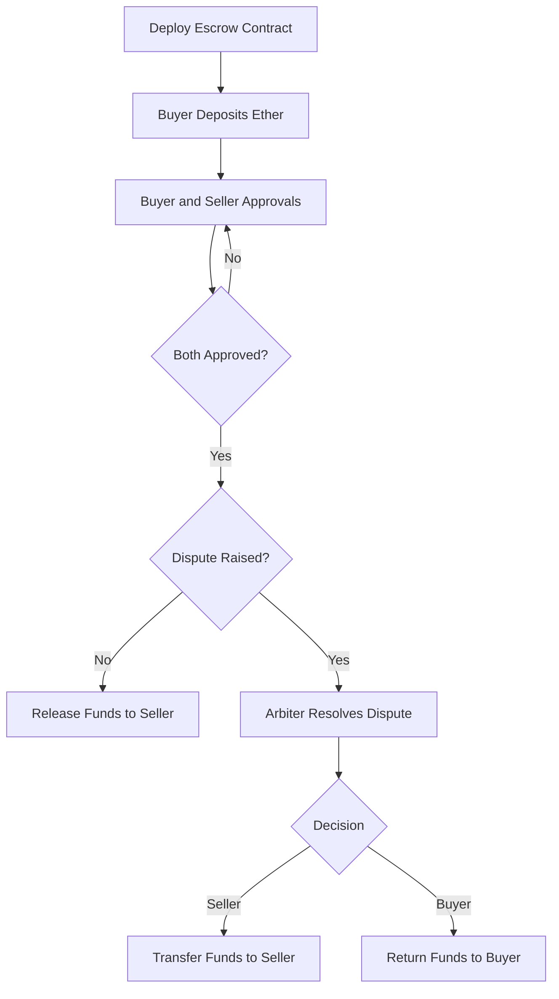

# Escrow Smart Contract

A Solidity-based Escrow smart contract built with Foundry to manage Ether deposits, buyer and seller approvals, conditional fund releases, and dispute resolution.

The project demonstrates the implementation, testing, deployment, and source verification of an Ethereum smart contract through a practical two-day development journey.

<p align="center">
  <a href="https://sepolia.etherscan.io/address/0x87Be26BfA7714A1E50aAF60C712f7b3dc3Bc809D">
    
  </a>
  <a href="https://sepolia.etherscan.io/address/0x87Be26BfA7714A1E50aAF60C712f7b3dc3Bc809D">
    
  </a>
  
  
  
  
</p>

## Table of Contents

- [Overview](#overview)
- [Live Deployment](#live-deployment)
- [How Escrow Works](#how-escrow-works)
- [Participants and Responsibilities](#participants-and-responsibilities)
- [Contract Features](#contract-features)
- [Contract Architecture](#contract-architecture)
- [State Variables](#state-variables)
- [Custom Errors](#custom-errors)
- [Core Functions](#core-functions)
- [Fund Release Mechanism](#fund-release-mechanism)
- [Dispute Resolution](#dispute-resolution)
- [Ether Transfer Handling](#ether-transfer-handling)
- [Technology Stack](#technology-stack)
- [Repository Structure](#repository-structure)
- [Getting Started](#getting-started)
- [Testing](#testing)
- [Test Coverage](#test-coverage)
- [Deployment](#deployment)
- [Contract Verification](#contract-verification)
- [Configuration and Security](#configuration-and-security)
- [Known Limitations](#known-limitations)
- [Development Journey](#development-journey)
- [References](#references)
- [Author](#author)

## Overview

An Escrow contract is a smart contract that temporarily holds funds until predefined conditions are satisfied.

Instead of transferring Ether directly between a buyer and a seller, the buyer deposits funds into the contract. The funds remain locked until both parties approve the transaction or an authorized arbiter resolves a dispute.

This project implements a basic three-party Escrow mechanism on Ethereum.

It explores how Solidity can be used to:

- Receive and hold Ether.
- Restrict operations based on participant roles.
- Require independent approvals from multiple parties.
- Release funds when predefined conditions are met.
- Handle disputes through an authorized arbiter.
- Manage failed Ether transfers using custom errors.

The project was developed using Solidity and Foundry, with testing performed locally before deployment to the Ethereum Sepolia testnet.

## Live Deployment

The Escrow contract is deployed on the Ethereum Sepolia testnet.

| Deployment Information | Details |
|---|---|
| Network | Ethereum Sepolia |
| Chain ID | 11155111 |
| Contract Name | Escrow |
| Contract Address | `0x87Be26BfA7714A1E50aAF60C712f7b3dc3Bc809D` |
| Initial Deposit | 0.01 ETH |
| Compiler | Solidity 0.8.37 |

### Explore the Deployed Contract

- [View on Etherscan](https://sepolia.etherscan.io/address/0x87Be26BfA7714A1E50aAF60C712f7b3dc3Bc809D)
- [View on Sourcify](https://repo.sourcify.dev/contracts/full_match/11155111/0x87Be26BfA7714A1E50aAF60C712f7b3dc3Bc809D/)
- [View on Blockscout](https://eth-sepolia.blockscout.com/address/0x87Be26BfA7714A1E50aAF60C712f7b3dc3Bc809D)

This is a testnet deployment. The contract uses test Ether and is intended for learning and experimentation.

## How Escrow Works

The contract follows a straightforward approval-based workflow.

1. The contract is deployed with the buyer, seller, and arbiter addresses.
2. The buyer deposits Ether into the contract during deployment.
3. The buyer and seller independently approve the transaction.
4. Once both approvals are received, the contract attempts to release the funds to the seller.
5. If either participant raises a dispute, the normal release mechanism is blocked.
6. The arbiter can resolve the dispute by choosing the recipient of the deposited funds.

### Workflow



## Participants and Responsibilities

The contract involves three participants, each with a specific responsibility.

### Buyer

The buyer is the participant who deposits Ether into the Escrow contract.

Responsibilities:

- Provides the initial deposit during contract deployment.
- Approves the transaction through `approveByBuyer()`.
- Can raise a dispute if an issue occurs.

### Seller

The seller is the participant who receives the deposited Ether when the required conditions are satisfied.

Responsibilities:

- Approves the transaction through `approveBySeller()`.
- Can raise a dispute if an issue occurs.
- Receives the funds after both parties approve and no dispute has been raised.

### Arbiter

The arbiter is the authorized third party responsible for resolving disputes.

Responsibilities:

- Can resolve an existing dispute.
- Can approve the release of funds to the seller.
- Can return the deposited funds to the buyer.

Only the configured arbiter address can execute `resolveDispute()`.

## Contract Features

- Three-party Escrow architecture.
- Initial Ether deposit through a payable constructor.
- Buyer and seller approval mechanisms.
- Conditional fund release.
- Dispute raising by either participant.
- Arbiter-controlled dispute resolution.
- Fund release to either the buyer or seller.
- Access control through participant address checks.
- Custom errors for failed authorization and invalid operations.
- Low-level Ether transfers using `call`.
- Foundry unit and negative testing.
- Sepolia deployment and source verification.

## Contract Architecture

The project uses a straightforward Solidity contract with state variables representing the participants, deposited amount, and approval/dispute status.

The main contract is:

```text
src/Escrow.sol
```

The contract is initialized through a payable constructor.

```solidity
constructor(
    address _buyer,
    address _seller,
    address _arbiter
) payable {
    buyer = _buyer;
    seller = _seller;
    arbiter = _arbiter;
    amount = msg.value;
}
```

The constructor stores the participant addresses and records the Ether amount received during deployment.

### Why Payable?

The `payable` modifier allows a function or constructor to receive Ether.

In this project, the constructor is payable so that the initial Escrow deposit can be sent in the same transaction that deploys the contract.

`msg.value` represents the amount of Ether sent with that transaction, denominated in wei.

## State Variables

The contract maintains the following state variables:

| Variable | Type | Purpose |
|---|---|---|
| `buyer` | `address` | Stores the buyer's address. |
| `seller` | `address` | Stores the seller's address. |
| `arbiter` | `address` | Stores the arbiter's address. |
| `amount` | `uint256` | Stores the initial deposited amount. |
| `buyerApproved` | `bool` | Tracks the buyer's approval. |
| `sellerApproved` | `bool` | Tracks the seller's approval. |
| `isDisputeRaised` | `bool` | Tracks whether a dispute has been raised. |

These variables define the contract's basic state and determine whether funds can be released through the normal approval mechanism.

## Custom Errors

Custom errors provide a structured way to handle failed conditions in Solidity.

Instead of using traditional string-based revert messages, this contract defines custom errors:

```solidity
error Escrow_onlyBuyer();
error Escrow_onlySeller();
error Escrow_onlyBuyerOrSeller();
error Escrow_onlyArbiter();
error Escrow_NoDisputeRaised();
error Escrow_TransferFailed();
```

They are triggered using the `revert` statement:

```solidity
if (msg.sender != buyer) {
    revert Escrow_onlyBuyer();
}
```

### Why Use Custom Errors?

Traditional string-based reverts encode descriptive text into the revert data.

Custom errors use a compact error selector and ABI-encoded arguments, if any.

This can reduce the amount of revert data and the gas cost associated with reverting compared with string-based error messages.

Custom errors also make failure conditions easier to identify and handle in tests and off-chain applications.

In this project, they are used for:

- Unauthorized buyer operations.
- Unauthorized seller operations.
- Unauthorized dispute operations.
- Unauthorized arbiter operations.
- Attempting to resolve a dispute that does not exist.
- Failed Ether transfers.

## Core Functions

### `approveByBuyer()`

Allows only the configured buyer to approve the transaction.

After recording the approval, it calls the internal `releaseIfAgreed()` function to check whether the release conditions have been satisfied.

### `approveBySeller()`

Allows only the configured seller to approve the transaction.

Like the buyer approval function, it calls `releaseIfAgreed()` after recording the approval.

### `releaseIfAgreed()`

An internal function that checks the following conditions:

- The buyer has approved.
- The seller has approved.
- No dispute has been raised.

If all conditions are satisfied, it attempts to transfer the stored amount to the seller.

### `raiseDispute()`

Allows either the buyer or seller to raise a dispute.

Unauthorized addresses are rejected through a custom error.

Once a dispute is raised, the normal fund release condition is no longer satisfied.

### `resolveDispute(bool _approveForSeller)`

Allows only the arbiter to resolve an existing dispute.

The boolean parameter determines the recipient:

- `true`: Transfer the funds to the seller.
- `false`: Return the funds to the buyer.

The function also checks that a dispute has already been raised.

## Fund Release Mechanism

The contract uses Solidity's low-level `call` to transfer Ether.

Example:

```solidity
(bool success, ) = seller.call{value: amount}("");

if (!success) {
    revert Escrow_TransferFailed();
}
```

The call returns a boolean indicating whether the external call succeeded.

The contract checks this result and reverts if the transfer fails.

This mechanism is also used when the arbiter resolves a dispute in favor of either participant.

## Dispute Resolution

Disputes are an important part of the Escrow workflow.

Either the buyer or seller can raise a dispute through `raiseDispute()`.

When a dispute is raised:

- `isDisputeRaised` becomes `true`.
- The normal approval-based release condition no longer allows funds to be released.
- The arbiter becomes responsible for choosing the recipient through `resolveDispute()`.

This implementation demonstrates a basic arbiter-based dispute mechanism.

## Ether Transfer Handling

Ether transfers can fail for different reasons, including recipient contracts that reject incoming Ether.

The project handles failed transfers by checking the success value returned by `call`.

If the transfer fails, the contract reverts with:

```solidity
Escrow_TransferFailed();
```

The test suite includes a `RejectEther` helper contract to simulate a recipient that cannot receive Ether.

This makes it possible to test the contract's failure-handling behavior rather than testing only successful transfers.

## Technology Stack

| Technology | Usage |
|---|---|
| Solidity | Smart contract implementation. |
| Foundry | Development, testing, and deployment framework. |
| Forge | Contract compilation, testing, and deployment. |
| Anvil | Local Ethereum development environment. |
| Cast | Command-line interaction with Ethereum. |
| Git | Version control. |
| GitHub | Source code hosting and project documentation. |
| Ethereum Sepolia | Smart contract deployment testnet. |
| Etherscan | Contract inspection and source verification. |
| Sourcify | Decentralized source verification service. |
| Blockscout | Blockchain explorer and contract inspection. |
| GNU Make | Simplifying deployment and verification commands. |

## Repository Structure

```text
escrow-smart-contract/
│
├── days/
│   ├── day-01/
│   │   └── README.md
│   │
│   └── day-02/
│       └── README.md
│
├── lib/
│   └── forge-std/
│
├── script/
│
├── src/
│   └── Escrow.sol
│
├── test/
│   └── Escrow.t.sol
│
├── .env                 # Local environment configuration (not committed)
├── .gitignore
├── foundry.toml
├── Makefile
└── README.md
```

## Getting Started

### Prerequisites

Install the following tools:

- Git
- Foundry
- A code editor such as Visual Studio Code

### Clone the Repository

```bash
git clone https://github.com/Hassan5737/escrow-smart-contract.git
cd escrow-smart-contract
```

### Install Dependencies

```bash
forge install
```

### Build the Project

```bash
forge build
```

### Run the Tests

```bash
forge test
```

### Generate Coverage

```bash
forge coverage
```

## Testing

The test suite is located at:

```text
test/Escrow.t.sol
```

It contains 18 tests covering the contract's initialization, access control, approvals, fund release, dispute handling, and transfer failure scenarios.

### Test Scenarios

| Test Area | Scenarios |
|---|---|
| Constructor | Initial addresses, amount, balance, and state. |
| Buyer Approval | Authorization and approval without premature release. |
| Seller Approval | Authorization and approval without premature release. |
| Fund Release | Both possible approval sequences. |
| Dispute Protection | Preventing normal release after a dispute. |
| Transfer Failure | Handling a seller that rejects Ether. |
| Raise Dispute | Buyer, seller, and unauthorized caller. |
| Resolve Dispute | Arbiter authorization and missing dispute. |
| Dispute Outcome | Releasing funds to seller or returning them to buyer. |
| Resolution Transfer Failure | Failed transfers to either recipient. |

### Running Individual Tests

Run the complete test suite:

```bash
forge test
```

Run tests with detailed execution traces:

```bash
forge test -vvvv
```

Generate the coverage report:

```bash
forge coverage
```

## Test Coverage

The final coverage report showed:

| Metric | Result |
|---|---:|
| Lines | 100% |
| Statements | 100% |
| Branches | 100% |
| Functions | 100% |
| Total Tests | 18 |
| Passed | 18 |
| Failed | 0 |
| Skipped | 0 |

All four reported coverage metrics reached 100% for the Escrow contract.

Coverage is a measurement of how much code was exercised during testing. It should not be interpreted as a security audit or a guarantee that the contract is free from vulnerabilities.

## Deployment

The contract was deployed to Ethereum Sepolia using Foundry's `forge create` command.

The deployment process uses a local `.env` file and a Makefile to organize configuration and commands.

Example environment configuration:

```env
RPC_URL=YOUR_SEPOLIA_RPC_URL
BUYER=YOUR_BUYER_ADDRESS
SELLER=YOUR_SELLER_ADDRESS
ARBITER=YOUR_ARBITER_ADDRESS
ETHERSCAN_API_KEY=YOUR_ETHERSCAN_API_KEY
```

The actual `.env` file must remain local and must never be committed.

The Makefile provides the following commands:

```bash
make deploy
```

Deploys the Escrow contract using the configured participants and initial Ether deposit.

```bash
make verify
```

Submits the deployed contract for source verification.

The deployment uses a Foundry keystore account rather than placing a raw private key in the command.

## Contract Verification

The deployed contract's source code is available through:

- [Etherscan Verification](https://sepolia.etherscan.io/address/0x87Be26BfA7714A1E50aAF60C712f7b3dc3Bc809D)
- [Sourcify Verification](https://repo.sourcify.dev/contracts/full_match/11155111/0x87Be26BfA7714A1E50aAF60C712f7b3dc3Bc809D/)
- [Blockscout Contract Page](https://eth-sepolia.blockscout.com/address/0x87Be26BfA7714A1E50aAF60C712f7b3dc3Bc809D)

Source verification makes the deployed contract code publicly inspectable. It does not represent an independent security audit.

## Configuration and Security

This repository uses environment variables to separate local deployment configuration from source code.

The `.env` file is excluded through `.gitignore`.

Before deploying your own instance:

1. Configure your Sepolia RPC endpoint.
2. Set the buyer, seller, and arbiter addresses.
3. Configure your Etherscan API key.
4. Ensure your Foundry keystore account is available.
5. Never expose private keys or API credentials.
6. Confirm the constructor arguments and deployment value before broadcasting.

## Known Limitations

This project represents an initial educational implementation of an Escrow mechanism. It is not intended to be used for production transactions or real funds.

The current implementation has several limitations that are important to understand:

- It does not maintain an explicit finalized or released state after a successful payout.
- It does not prevent repeated calls to dispute resolution after a dispute has been raised.
- It does not include a dedicated reentrancy protection mechanism or a checks-effects-interactions state transition.
- The constructor does not validate zero addresses or require a non-zero deposit.
- The contract does not emit events for approvals, dispute creation, or fund transfers.
- The contract does not provide a complete lifecycle management mechanism for every possible state transition.

These limitations are intentionally documented rather than hidden. They provide clear areas for future development and security improvements.

A future version will focus on stronger state management, safer external interactions, additional validation, event emission, and broader testing before considering any production use.

## Development Journey

This project was developed and documented across two stages.

### Day 01 – Escrow Fundamentals & Implementation

Topics covered:

- Understanding Escrow smart contracts.
- Contract layout and structure.
- Constructor and initial Ether deposit.
- Buyer and seller approvals.
- Conditional fund release.
- Raising and resolving disputes.
- Solidity custom errors.

[Read Day 01 Documentation](days/day-01/README.md)

### Day 02 – Testing & Deployment

Topics covered:

- Foundry test setup.
- Constructor and approval tests.
- Positive and negative test scenarios.
- Dispute and transfer failure testing.
- Test coverage analysis.
- Sepolia deployment.
- Contract source verification.

[Read Day 02 Documentation](days/day-02/README.md)

## References

- [Solidity Documentation](https://docs.solidity.org/)
- [Solidity Custom Errors](https://docs.solidity.org/en/latest/contracts.html#custom-errors)
- [Foundry Documentation](https://book.getfoundry.sh/)
- [Foundry Testing](https://book.getfoundry.sh/forge/tests)
- [Foundry Coverage](https://book.getfoundry.sh/forge/reference/coverage)
- [Ethereum Developer Documentation](https://ethereum.org/developers/docs/)
- [Ethereum Virtual Machine](https://ethereum.org/developers/docs/evm/)

## Author

**Hassan Ahmed Hassan**

Software Engineer focused on Backend Engineering and Blockchain & Web3.

- GitHub: [Hassan5737](https://github.com/Hassan5737)
- LinkedIn: [Hassan Ahmed Assad](https://www.linkedin.com/in/hassan-ahmed-assad/)

---

This project is part of my ongoing Blockchain & Web3 development journey, focused on learning through implementation, testing, and continuous improvement.

**Build. Test. Learn. Improve.**